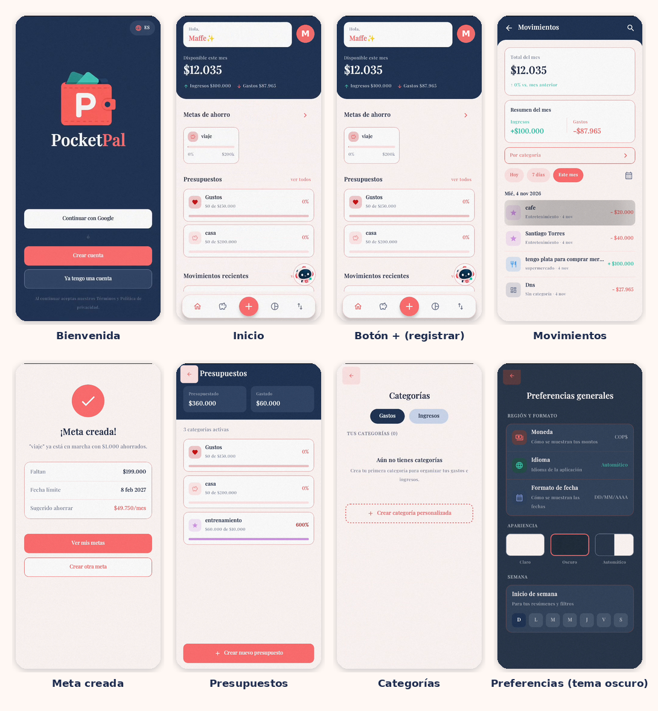
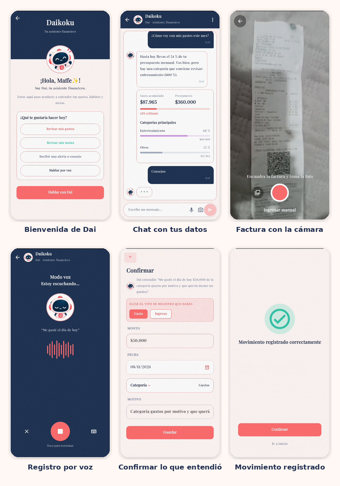
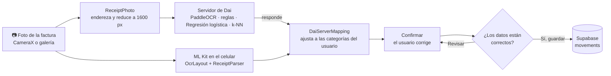
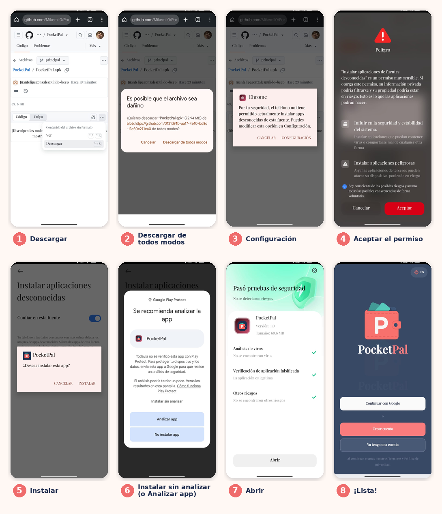
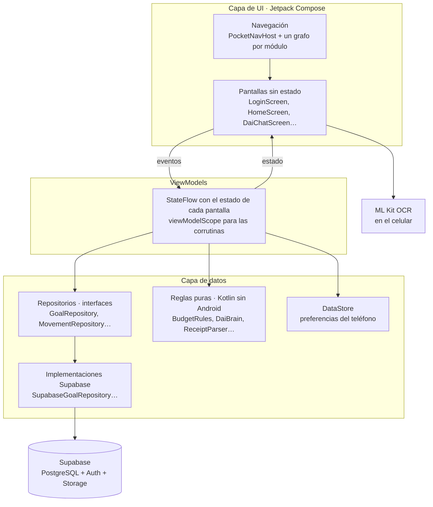
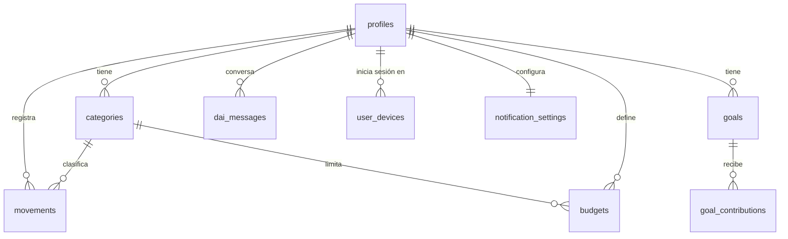

<div align="center">


# PocketPal

**Tu bolsillo, bajo control.** App Android para manejar tus finanzas personales, con **Dai**, un asistente que lee tus facturas con la cámara, entiende lo que le dices por voz y te avisa cuando estás gastando de más.


-3DDC84?logo=android&logoColor=white)

</div>

---

## Contenido

1. [Equipo](#equipo)
2. [Entrega](#entrega)
3. [¿Qué hace la app?](#qué-hace-la-app)
4. [Capturas](#capturas)
5. [Dai, el asistente con IA](#dai-el-asistente-con-ia)
6. [Instalación rápida (APK)](#instalación-rápida-apk)
7. [Compilar desde el código](#compilar-desde-el-código)
8. [Arquitectura](#arquitectura)
9. [Base de datos](#base-de-datos)
10. [Pruebas](#pruebas)
11. [Tecnologías](#tecnologías)
12. [Seguridad](#seguridad)

---

## Equipo

Proyecto del curso de desarrollo de aplicaciones móviles · Universidad de Bogotá Jorge Tadeo Lozano · 2026.

| Integrante | GitHub |
|---|---|
| Juan Felipe González Pulido | [@juanfelipegonzalezpulido-beep](https://github.com/juanfelipegonzalezpulido-beep) |
| María Fernanda De la Pava | [@Maffecita](https://github.com/Maffecita) |
| Juan Camilo Alarcón Santa María | [@Mikemil0](https://github.com/Mikemil0) |
| Angye Téllez | [@angietllz](https://github.com/angietllz) |

El aporte de cada integrante se ve en el [historial de commits](https://github.com/Mikemil0/PocketPal/commits/main): cada flujo se subió en un commit propio (pantalla → base de datos → pantalla).

## Entrega

| | |
|---|---|
| **Repositorio** | https://github.com/Mikemil0/PocketPal |
| **Rama con la última versión funcional** | [`main`](https://github.com/Mikemil0/PocketPal/tree/main) |
| **APK para instalar** | [`PocketPal.apk`](https://github.com/Mikemil0/PocketPal/raw/main/PocketPal.apk), en la raíz del repositorio |
| **Diseño** | Figma "PocketPal" (módulos 1 a 6) |

---

## ¿Qué hace la app?

La app se construyó por **módulos**, siguiendo el diseño de Figma:

| Módulo | Qué incluye |
|---|---|
| **1 · Autenticación** | Registro con verificación del correo (código OTP de 6 dígitos), inicio de sesión con correo o con **Google**, "Recordarme", recuperación de contraseña, tutorial de bienvenida y permisos (notificaciones, cámara y micrófono). |
| **2 · Perfil** | Datos personales y foto, teléfono con verificación por SMS, seguridad y **sesiones activas** (cerrar sesión en otros dispositivos), notificaciones, **categorías** de gastos e ingresos, preferencias (idioma, tema, moneda, formato de fecha), **exportar datos** (PDF/CSV), ayuda y acerca de. La app está en **4 idiomas**: español, inglés, portugués y francés. |
| **3 · Metas de ahorro** | Crear metas con fecha límite, ver el progreso, agregar aportes, historial, editar, reordenar y eliminar. |
| **4 · Movimientos** | Lista de ingresos y gastos por día, búsqueda con filtros, detalle (compartir o descargar el comprobante en PDF, o eliminar el movimiento), movimientos recurrentes, gastos del mes por categoría y calendario para elegir fechas. |
| **5 · Presupuestos** | Límite por categoría (semanal o mensual), cuánto llevas gastado y cuánto queda, historial por período, crear, editar y eliminar. |
| **6 · Dai** | El asistente con IA: chat sobre tus finanzas, alertas, seguimiento de metas, educación financiera, **lectura de facturas con la cámara**, **registro por voz** y registro manual desde el botón **+** del inicio. |

---

## Capturas

Tomadas de la app instalada en un celular Android.

<div align="center">

</div>

---

## Dai, el asistente con IA

<div align="center">


*Dai cambia de expresión según lo que te está diciendo.*


</div>

### Lo que hace

- **Conversa con tus datos reales.** "¿Cómo voy con mi presupuesto?", "¿en qué gasto más?", "¿cuándo llego a mi meta?". Responde con tarjetas: gastos por categoría, metas y alertas.
- **Te avisa.** Si en los últimos días gastaste mucho en una categoría, calcula cuánto gastarías al final del mes a ese ritmo.
- **Te enseña.** Explica conceptos como el interés compuesto o la regla 50/30/20, con un video recomendado.
- **Lee facturas.** Le tomas una foto (o la eliges de la galería) y saca el **monto, la fecha, la categoría y el motivo**.
- **Entiende tu voz.** Dices *"Gasté 45 mil pesos en mercado"* y queda listo un gasto de $45.000 en Comida.
- **Nunca guarda nada sin tu permiso.** Siempre te muestra los datos y **dónde se van a guardar** (por ejemplo, *"Presupuesto Comida: de 84 % a 88 %"*) y espera a que digas **"Sí, guardar"**.

### Cómo lee una factura

Dai tiene **dos lectores**. El principal es **PaddleOCR**, el modelo que el equipo escogió en el proyecto de Inteligencia Artificial tras comparar 4 OCR (Tesseract, EasyOCR, docTR y PaddleOCR) con 143 facturas reales. Corre en el **servidor de Dai**. Si el servidor no está configurado o no responde, la app usa el lector del celular, **ML Kit**, y nunca se queda sin leer.



**Servidor de Dai (modelo del proyecto de IA)**
1. La app envía la foto (`POST /analizar`) mientras ML Kit lee en el celular.
2. El servidor responde los 4 campos:

   | Campo | Modelo |
   |---|---|
   | Texto de la foto | **PaddleOCR** (versión *mobile*) |
   | Monto y fecha | Reglas de extracción |
   | Categoría | TF-IDF por caracteres + **Regresión logística** |
   | Motivo | **k-NN** (k = 1, distancia coseno) |

3. **`DaiServerMapping`** pasa la categoría del dataset a la del usuario (Supermercado y Restaurantes → Comida, Servicios → Hogar, Ropa → Compras). Además descarta una fecha futura, como la fecha límite de un recibo.
4. La dirección del servidor se pega en **Dai → Configuración de Dai → Servidor de Dai**. Si se deja vacía, solo se usa ML Kit.

**Lector del celular (respaldo, sin internet)**
1. **ML Kit Text Recognition** (Google) lee el texto **dentro del celular**.
2. ML Kit entrega el texto **por bloques** (columnas), así que la palabra "TOTAL" y el valor "$17.900" llegan separados. **`OcrLayout`** usa la posición de cada línea en la foto para volver a armar las **filas** de la factura.
3. **`ReceiptParser`** elige el total con un **puntaje**:
   - "TOTAL A PAGAR" vale más que "TOTAL";
   - si la etiqueta quedó sin número, toma el valor de la fila de abajo;
   - si no hay etiqueta, usa "Efectivo − Cambio";
   - descarta el NIT, los teléfonos, las fechas, el IVA, el subtotal y el cambio;
   - corrige errores típicos del OCR: `17.9OO` → `17.900` y `S17.900` → `$17.900`.

   Para la **fecha**, descarta las de la resolución de la DIAN y su vigencia, prefiere la línea que dice "Fecha" o "Fecha creación" y toma la más reciente que no sea futura.

En los dos casos, el usuario revisa los datos en **Confirmar**, ve dónde se guardará el gasto y lo **aprueba**. Dai nunca guarda solo.

### Cómo entiende la voz

`SpeechRecognizer` de Android convierte el audio en texto (español de Colombia). Después **`VoiceMovementParser`** saca de la frase:
- el **tipo**: "me pagaron" es ingreso;
- el **monto**: "45 mil", "cuarenta y cinco mil", "2 millones 500 mil";
- la **fecha**: "ayer", "hace 3 días";
- la **categoría**: "taxi" va a Transporte;
- el **motivo**.

---

## Instalación rápida (APK)

La forma más fácil de probar la app es instalar el APK en un celular Android (8.0 o superior). Así se ve el proceso completo en un celular real:

<div align="center">

</div>

1. **Descargar.** Desde el celular abre [`PocketPal.apk`](https://github.com/Mikemil0/PocketPal/blob/main/PocketPal.apk) en GitHub (está en la raíz del repositorio) y toca **⋯ → Descargar**. También sirve el enlace directo: [descargar PocketPal.apk](https://github.com/Mikemil0/PocketPal/raw/main/PocketPal.apk).
2. **Descargar de todos modos.** Chrome avisa que *"es posible que el archivo sea dañino"* porque es un APK que no viene de Play Store.
3. **Configuración.** Al abrir el archivo, Android dice que no tiene permitido instalar apps desconocidas de esta fuente: toca **Configuración**.
4. **Aceptar el permiso.** Activa **Confiar en esta fuente** (en algunos celulares hay que marcar *"Soy consciente de los posibles riesgos"* y tocar **Aceptar**) y vuelve atrás.
5. **Instalar.** Toca **Instalar**.
6. **Play Protect.** Como la app no está publicada en Play Store, Google ofrece analizarla: toca **Analizar app** o **Instalar sin analizar**.
7. **Abrir.** Cuando termine, toca **Abrir**.
8. **¡Lista!** Toca **Crear cuenta**, escribe tu correo y contraseña, y el **código de 6 dígitos** que llega al correo. Acepta los permisos de **cámara** y **micrófono**: Dai los usa para leer facturas y escucharte.

> Para ver datos de ejemplo de una vez, el administrador del proyecto puede cargarlos con `seed_demo_movements('tu@correo.com')` y `seed_demo_budgets('tu@correo.com')` en el SQL Editor de Supabase.

---

## Compilar desde el código

### Requisitos

- **Android Studio** en una versión reciente (el proyecto usa AGP 9). Ya trae el JDK que se necesita.
- Un celular Android 8.0+ o un emulador (se probó en **Pixel 6, API 37**).
- Un proyecto de **Supabase** y, para el inicio de sesión con Google, un proyecto de **Google Cloud**.

### 1. Clonar y abrir

```bash
git clone https://github.com/Mikemil0/PocketPal.git
```

En Android Studio: **File → Open** → carpeta **`PocketPal/PocketPal01/Pocketpal`** (la que tiene `gradlew`). Espera a que termine el **Gradle Sync**.

### 2. Preparar Supabase

1. Crea un proyecto en [supabase.com](https://supabase.com).
2. En **SQL Editor**, ejecuta **en este orden** los archivos de `PocketPal01/Pocketpal/supabase/migrations/`:

   | # | Archivo | Qué crea |
   |---|---|---|
   | 1 | `20261014000000_module2_profile.sql` | `profiles`, `categories`, `notification_settings`, `user_devices`, bucket `avatars` |
   | 2 | `20261021000000_module3_goals.sql` | `goals`, `goal_contributions` |
   | 3 | `20261026000000_module4_movements.sql` | `movements` |
   | 4 | `20261028000000_module5_budgets.sql` | `budgets` |
   | 5 | `20261101000000_module6_dai.sql` | `dai_messages` |

3. En **Authentication → Providers → Email**, deja activado **Confirm email**.
4. En **Authentication → Email Templates** (*Confirm signup* y *Reset Password*), usa `{{ .Token }}` en el cuerpo del correo. Así llega un código de 6 dígitos y no un enlace.
5. *(Opcional, para "Sesiones activas")* Despliega la función `supabase/functions/revoke-device` con `supabase functions deploy revoke-device`.

### 3. Inicio de sesión con Google (opcional)

En [Google Cloud Console](https://console.cloud.google.com):
1. Crea una **pantalla de consentimiento OAuth** (Externo) y agrega los correos de prueba.
2. Crea un **OAuth client ID de tipo Android**: paquete `com.pocketpal.app` y el **SHA-1** de tu llave de depuración (en Android Studio: Gradle → `signingReport`).
3. Crea un **OAuth client ID de tipo Web**. Ese es el que usa la app.
4. En Supabase → **Authentication → Providers → Google**: actívalo con el Client ID y el secreto **Web**.

### 4. Llaves locales

Copia `PocketPal01/Pocketpal/local.properties.example` como **`local.properties`** en la misma carpeta y llena:

| Clave | Dónde sale |
|---|---|
| `SUPABASE_URL` | Supabase → Project Settings → API → URL |
| `SUPABASE_KEY` | Supabase → Project Settings → API → clave **publishable / anon** (nunca la `service_role`) |
| `GOOGLE_WEB_CLIENT_ID` | Google Cloud → Credentials → cliente **Web** |

`local.properties` está en `.gitignore`: **nunca se sube al repositorio**. Gradle lee esas llaves y las pasa a la app con `BuildConfig`.

### 5. Ejecutar

Botón **Run ▶** de Android Studio, o por terminal desde `PocketPal01/Pocketpal`:

```powershell
.\gradlew.bat :app:assembleDebug        # genera app/build/outputs/apk/debug/app-debug.apk
.\gradlew.bat :app:testDebugUnitTest    # corre las pruebas
```

> Si `gradlew` dice *"JAVA_HOME is not set"*: `$env:JAVA_HOME = 'C:\Program Files\Android\Android Studio\jbr'`

---

## Arquitectura

La app usa **MVVM** (Model–View–ViewModel) con **flujo de datos unidireccional**: el estado baja de los ViewModels a las pantallas y los eventos (clics, texto) suben de las pantallas a los ViewModels.



- **Pantallas sin estado.** Reciben el estado y lambdas (`onSave`, `onBack`…). El **componente padre** es el grafo de navegación, que lee el ViewModel con `collectAsStateWithLifecycle()` y le pasa los datos a la pantalla (*state hoisting*).
- **ViewModels.** Exponen un `StateFlow` (`Loading` / `Content` / `Error`) y sobreviven a la rotación del celular. Se crean una vez en `MainActivity`.
- **Repositorios.** Son **interfaces**, así que el ViewModel no sabe que detrás está Supabase. En las pruebas se cambian por repositorios falsos (`FakeGoalRepository`…).
- **Inyección de dependencias manual.** `AppContainer` crea un solo cliente de Supabase y los repositorios.
- **Reglas puras.** Los cálculos (presupuestos, metas, lo que entiende Dai, la lectura de facturas) son Kotlin sin Android. Por eso se prueban con JUnit.

### Estructura de carpetas

```
PocketPal/
├── README.md
├── assets/readme/                    ← imágenes del README
└── PocketPal01/Pocketpal/            ← proyecto de Android Studio
    ├── local.properties.example      ← plantilla de las llaves
    ├── supabase/
    │   ├── migrations/               ← tablas, RLS y funciones (un .sql por módulo)
    │   └── functions/revoke-device/  ← Edge Function para cerrar sesiones
    └── app/src/
        ├── main/java/com/pocketpal/app/
        │   ├── MainActivity.kt       ← crea los ViewModels y arranca la navegación
        │   ├── auth/                 ← sesión, Supabase y Google
        │   ├── di/AppContainer.kt    ← inyección de dependencias
        │   ├── data/                 ← modelos, reglas y repositorios
        │   │   ├── budget/  category/  goal/  movement/  profile/ …
        │   │   └── dai/              ← DaiBrain, ReceiptParser, OcrLayout, VoiceMovementParser
        │   ├── navigation/           ← Routes, PocketNavHost y un grafo por módulo
        │   └── ui/
        │       ├── auth/  onboarding/  home/       ← módulo 1 e inicio
        │       ├── profile/  goals/  movements/  budgets/
        │       ├── dai/  newmovement/              ← módulo 6
        │       ├── components/       ← botones, campos y hojas reutilizables
        │       └── theme/            ← colores, tipografía y tema claro/oscuro
        ├── main/res/                 ← textos en 4 idiomas, imágenes de Dai
        └── test/                     ← pruebas unitarias (JUnit)
```

---

## Base de datos

Todo se guarda en **Supabase** (PostgreSQL en la nube). Cada tabla tiene **Row Level Security (RLS)**: un usuario solo puede leer y escribir **sus propias filas**, aunque la consulta no filtre por usuario.



| Tabla | Para qué |
|---|---|
| `profiles` | Nombre, foto, teléfono, moneda e idioma (se crea sola al registrarse, con un *trigger*) |
| `categories` | Categorías de gastos e ingresos de cada usuario |
| `goals` / `goal_contributions` | Metas de ahorro y sus aportes (el total ahorrado lo recalcula un *trigger*) |
| `movements` | Ingresos y gastos. `source` dice si se registró a mano (`manual`) o con Dai (`dai`) |
| `budgets` | Presupuestos por categoría y período |
| `dai_messages` | La conversación con Dai (con tarjetas en JSON) |
| `user_devices` / `notification_settings` | Sesiones activas y preferencias de notificaciones |

En el celular, las **preferencias** (idioma, tema, "Recordarme", respuestas por voz de Dai) se guardan con **Preferences DataStore**.

---

## Pruebas

**298 pruebas unitarias** en 32 clases (JUnit + `kotlinx-coroutines-test`). Cubren:
- las reglas puras: presupuestos, metas, categorías, movimientos, lo que entiende Dai, la lectura de facturas y la voz;
- todos los ViewModels: cargar, validar, guardar, sin internet y reintentar.

Los ViewModels se prueban con **repositorios falsos**, sin Supabase ni Android.

```powershell
cd PocketPal01\Pocketpal
.\gradlew.bat :app:testDebugUnitTest
```

En Android Studio: clic derecho en la carpeta `app/src/test` → **Run 'Tests in…'**.

---

## Tecnologías

| Área | Tecnología |
|---|---|
| Lenguaje | Kotlin 2.2 · corrutinas y `StateFlow` |
| Interfaz | Jetpack Compose · Material 3 · Navigation Compose |
| Backend | Supabase (Auth, PostgREST, Storage, Edge Functions) con `supabase-kt` 3.5 |
| IA en el servidor de Dai | PaddleOCR · scikit-learn (Regresión logística, k-NN) · FastAPI |
| IA en el celular | ML Kit Text Recognition (OCR, respaldo) · `SpeechRecognizer` y `TextToSpeech` de Android |
| Cámara | CameraX 1.4 |
| Datos locales | Preferences DataStore |
| Imágenes | Coil |
| Inicio con Google | Credential Manager + Google Identity |
| Build | Gradle 9 · Android Gradle Plugin 9 · minSdk 26 · targetSdk 37 |

---

## Seguridad

- Las llaves de Supabase y de Google van **solo en `local.properties`**, que no se sube a GitHub. Si falta alguna, la app falla al iniciar y dice cuál falta.
- La app usa solo la llave **publishable/anon**. La `service_role` solo existe dentro de la Edge Function, en el servidor.
- **RLS** en todas las tablas: cada usuario ve únicamente sus datos.
- La foto de las facturas **no sale del celular**: el OCR corre localmente.
- Dai **no modifica tus finanzas sin tu aprobación**.

---

<div align="center">

Hecho con 💜 en Bogotá · Universidad de Bogotá Jorge Tadeo Lozano · 2026

</div>
